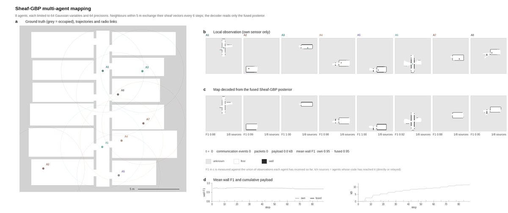

# Sheaf-GBP

Multi-agent map compression and fusion with a hard bottleneck: every agent describes its 2D occupancy map with **64 Gaussian variables and 64 diagonal precisions**. Agents exchange these over a radio forest, fuse them with Sheaf-GBP max-precision selection (a lattice join, so the result is exact on cycles, duplicates and stale packets), and decode the fused posterior back into a map. The decoder reads only the bottleneck.

Full history, pre-registered criteria and independent reviews are in [`claude_handoff/`](claude_handoff/). Start with [HANDOFF_20261023.md](claude_handoff/HANDOFF_20261023.md) and [BEST_RESULTS_20261023.md](claude_handoff/BEST_RESULTS_20261023.md).

## Results (wall F1, 2026-10-23)

K0 = decode from the agent's own code. R8 = decode after eight rounds of fusion. Two seeds. TRAIN fits, VALIDATION selects, TEST is sealed and never generated.

| World | VAL R8 | VAL K0 | Notes |
|---|---|---|---|
| HouseExpo (real floor plans) | .893 / .901 | .918 / .920 | house-fitted square chart, 14,400 TRAIN houses, three cosine cycles |
| HouseExpo, decoder channels x2 | .905 / .909 | .935 / .930 | same schedule; +1.2 / +0.8 pp vs the row above (pre-registered verdict: ambiguous, all 8 paired comparisons positive) |
| Synthetic v293 | .937 / .946 / .942 | ~.954 | three seeds; dynamic CRDT memory at t5: .937 |

Compression on v293: rate-term training (lambda 0.01) plus real arithmetic coding brings a self message from 27.2 B to 14.1 B at a cost of 0.3 to 0.9 pp R8.

What moved HouseExpo from R8 .64 to .90, one variable at a time: fit the chart to the house (+10 pp), more training houses (+5 to +10 pp), longer training (+2.4 pp for the second cosine cycle, +1.0 to +1.3 pp for the third). More bits per coordinate and rectangular charts did not help.

## Demo



Eight agents random-walk inside their own rooms or corridor segments of a synthetic v293 world. Every six steps, agents within 5 m exchange their 64-dimensional sheaf vectors (one gossip round, diff-coded packets), so codes from distant agents arrive over several hops and several communication events. Panel a shows the ground truth, trajectories and active radio links; b each agent's own cumulative observation; c the map each agent decodes from its fused posterior, with the number of agents whose code has reached it; d mean wall F1 and cumulative payload. Rendered by `scripts/claude_v342/demo_v385_walk.py` with the trained `ldynft-s342202` model; MP4s for 5 m and 8 m radio are in the same folder.

## Layout

| Path | Contents |
|---|---|
| `scripts/claude_v342/` | trainers (`train_v378.py` is current), data modules, cache generators, byte and rate evaluators, chain scripts for each batch |
| `claude_handoff/` | handoff notes, nightly report, best results, code reviews, figures, sealed v310 source snapshot |
| `configs/`, `exploration_grid/`, `archive/` | earlier experiment records |
| `src/piano_movers/`, `docs/piano_movers.md` | the earlier PianoMovers manipulation demo kept in this repo |

Model weights and run outputs stay on the GPU host under `/mnt/datasets/yuzhou-sheaf-gbp-research/claude-diag-20261021/runs/`; HouseExpo source data is not redistributed here.

## Running

Training needs the sealed v310 source tree and a CUDA GPU; see any `scripts/claude_v342/chain_day4_*.sh` for the exact command line and the pre-registered reading written before launch. Tests run on CPU:

```bash
python -m pytest -q scripts/claude_v342/test_v378_rect.py scripts/claude_v342/test_v375_stream.py
```

The earlier repository state is kept at [sheaf-gbp-control](https://github.com/YuzhouCheng66/sheaf-gbp-control).
